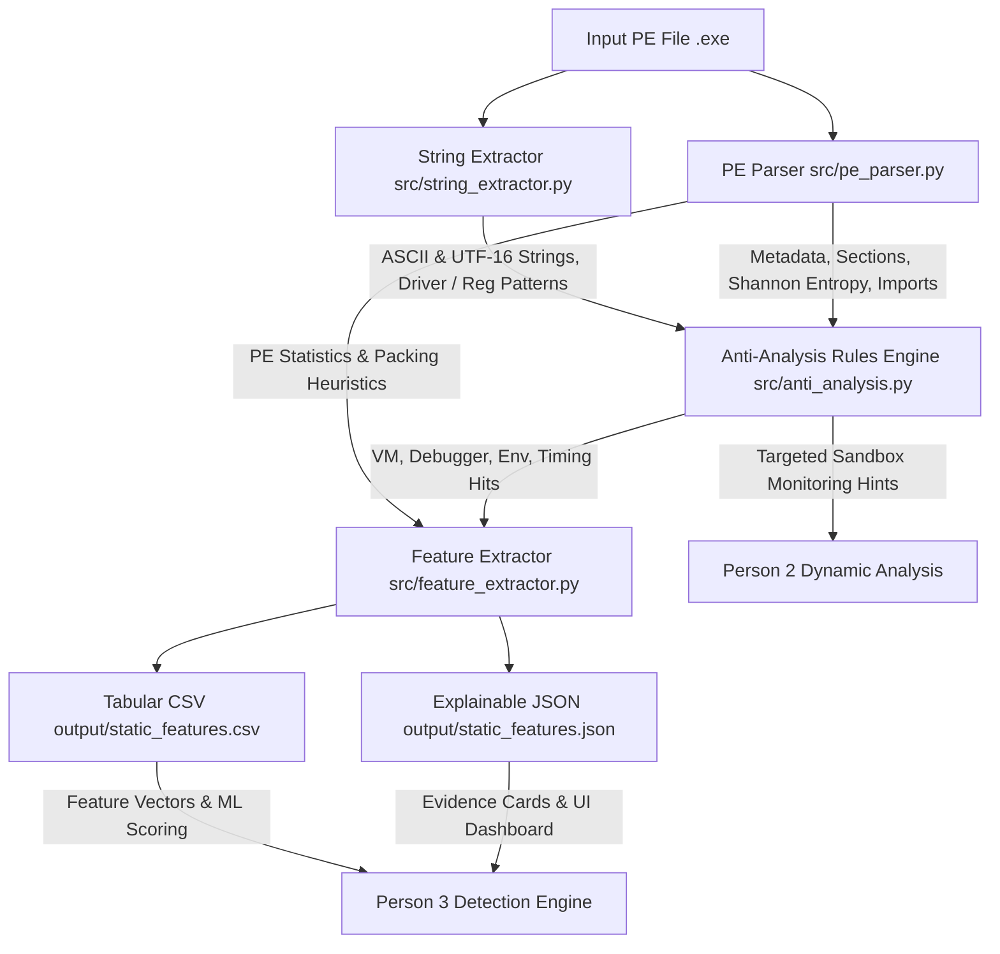

# Static Analysis & Feature Extraction System (Person 1)

> **Component 1 of 3** in the Multi-Stage Anti-Analysis & Malware Detection Pipeline.  
> **Main Responsibility:** Analyze target Portable Executables (`.exe`, `.dll`, `.sys`) statically without execution, identify evasion and anti-analysis mechanisms, and generate structured feature datasets for **Person 3's Detection Engine**.

---

## 📋 Table of Contents
- [Overview](#overview)
- [Architecture & Data Flow](#architecture--data-flow)
- [Project Structure](#project-structure)
- [Prerequisites & Installation](#prerequisites--installation)
- [Usage & Quick Start](#usage--quick-start)
  - [1. Single File Analysis](#1-single-file-analysis)
  - [2. Batch Directory Analysis](#2-batch-directory-analysis)
  - [3. Recompiling the Test Dataset](#3-recompiling-the-test-dataset)
- [Anti-Analysis Detection Rules](#anti-analysis-detection-rules)
- [Outputs & Handover to Person 2 and Person 3](#outputs--handover-to-person-2-and-person-3)
  - [Explainable JSON Report (`output/static_features.json`)](#explainable-json-report)
  - [Tabular Feature Dataset (`output/static_features.csv`)](#tabular-feature-dataset)
- [Benchmark Results](#benchmark-results)

---

## 🔍 Overview

Suspicious executables often embed evasion techniques designed to frustrate reverse engineers and evade automated malware analysis sandboxes. Person 1's role is to inspect the binary offline to extract:
1. **PE Structure & Metadata:** Header timestamps, machine architecture, entry points, subsystem.
2. **Section Characteristics & Entropy:** Shannon entropy per section to detect compression, cryptors, or packing ($H \ge 7.0$).
3. **Imports & Exports:** API functions and DLL dependencies indicative of evasive behaviors.
4. **Strings & Heuristic Artifacts:** ASCII and UTF-16LE strings, Registry paths, hypervisor driver names, and analysis tool keywords.
5. **Anti-Analysis Indicators:** Detection of Virtual Machines, Debuggers, Environment Checks, and Timing Checks.

---

## 📐 Architecture & Data Flow



---

## 📁 Project Structure

```text
sandbox/
├── README.md                          # Project README report (this file)
├── dataset/                           # Curated benign and suspicious PE samples
│   ├── benign/                        # Standard benign Windows and utility binaries
│   │   ├── attrib.exe
│   │   ├── ping.exe
│   │   ├── whoami.exe
│   │   └── benign_hello.exe
│   └── suspicious/                    # Targeted anti-analysis test binaries
│       ├── sample_anti_debug.exe
│       ├── sample_anti_vm.exe
│       ├── sample_env_checks.exe
│       ├── sample_timing_evasion.exe
│       ├── sample_multi_evasion.exe
│       └── sample_packed_crypt.exe
├── docs/
│   └── person1_methodology.md         # Comprehensive methodology and handover documentation
├── output/                            # Generated deliverables for Person 3
│   ├── static_features.json           # Explainable JSON dataset
│   └── static_features.csv            # 33-column tabular feature vector dataset
├── scripts/
│   └── prepare_dataset.py             # Dataset generation and C source compiler script
└── src/                               # Core Python static analysis implementation
    ├── __init__.py
    ├── analyzer.py                    # Main CLI and batch processing runner
    ├── anti_analysis.py               # Anti-analysis indicators & rule catalog
    ├── feature_extractor.py           # Feature transformer, serializer, and risk scorer
    ├── pe_parser.py                   # PE header, section, entropy, and import parser
    └── string_extractor.py            # ASCII/UTF-16 decoder with regex artifact scanner
```

---

## ⚙️ Prerequisites & Installation

- **Operating System:** Windows, Linux, or macOS.
- **Python:** 3.8 or higher.
- **Dependencies:**
  ```powershell
  pip install pefile
  ```
- *(Optional, for recompiling test binaries)*: MinGW GCC (`gcc`).

---

## 🚀 Usage & Quick Start

### 1. Single File Analysis
To scan an individual executable and view the interactive terminal report:
```powershell
python src/analyzer.py --file dataset/suspicious/sample_multi_evasion.exe
```

**Example Console Output:**
```text
=================================================================
 STATIC ANALYSIS REPORT: sample_multi_evasion.exe
=================================================================
 File Size     : 42990 bytes
 SHA256        : a1b0e02c1fbd08cbbea0bf4fe4b9d1a3cd03f4a47b6bffc6e126dff696bd8086
 Valid PE      : Yes
 Sections      : 13 (Max Entropy: 6.1087)
 Imports       : 59 functions from 2 DLLs
 Packed/Crypt  : No
-----------------------------------------------------------------
 ANTI-ANALYSIS INDICATORS:
  [*] VM Detection       : DETECTED
      - Strings matching VM/Hypervisor signatures: VBoxMouse.sys, 08:00:27:00:00:00
  [*] Debugger Detection : DETECTED
      - Anti-debugging APIs imported: outputdebugstringa, checkremotedebuggerpresent, isdebuggerpresent, setunhandledexceptionfilter
      - Debugger or analysis tool names found: x64dbg
  [*] Environment Checks : DETECTED
      - Hardware/environment enumeration APIs: globalmemorystatusex, getsysteminfo, createtoolhelp32snapshot
  [*] Timing Checks      : DETECTED
      - Timing APIs imported: sleep, gettickcount
      - Heuristic hit: High-resolution timer paired with sleep delay (evasion pattern)
      - Timing check strings: GetTickCount
-----------------------------------------------------------------
 STATIC RISK SCORE : 80.0/100 [HIGH]
  * VM / Hypervisor evasion indicators detected
  * Anti-debugging techniques detected
  * Environment / Sandbox fingerprinting checks detected
  * Timing manipulation / delay checks detected
=================================================================
```

### 2. Batch Directory Analysis
To scan an entire folder of executables and generate the datasets for Person 3:
```powershell
python src/analyzer.py --dir dataset/ --output-dir output/
```
This updates both:
- `output/static_features.json`
- `output/static_features.csv`

### 3. Recompiling the Test Dataset
To rebuild all benign and suspicious C-based test samples:
```powershell
python scripts/prepare_dataset.py
```

---

## 🛡️ Anti-Analysis Detection Rules

The rule catalog in [`src/anti_analysis.py`](file:///c:/Users/HP/OneDrive/Desktop/sandbox/src/anti_analysis.py) covers four distinct evasion categories:

| Category | Signature APIs | String & Artifact Signatures |
|---|---|---|
| **VM / Hypervisor Detection** | `GetSystemMetrics`, `SetupDiGetClassDevsA/W`, `DeviceIoControl`, `GetDiskFreeSpaceExA/W`, `wine_get_version` | VirtualBox (`VBoxGuestAdditions`, `VBoxMouse.sys`, `VBoxService`), VMware (`vmtoolsd.exe`, `vmmouse.sys`, `VMware Virtual IDE Hard Drive`), QEMU, Xen, MAC prefixes (`00:05:69`, `08:00:27`), SCSI registry keys |
| **Debugger Detection** | `IsDebuggerPresent`, `CheckRemoteDebuggerPresent`, `OutputDebugStringA/W`, `NtQueryInformationProcess`, `ZwQueryInformationProcess`, `NtSetInformationThread`, `FindWindowA`, `SetUnhandledExceptionFilter` | Tool names: `x64dbg`, `ollydbg`, `ida.exe`, `Wireshark`, `Process Hacker`, `immunity`, `dnspy`, `cheat engine` |
| **Environment Checks** | `GetSystemInfo`, `GetActiveProcessorCount` (CPU count), `GlobalMemoryStatusEx` (RAM checks), `CreateToolhelp32Snapshot`, `Process32First/Next`, `EnumProcesses` | Sandbox artifacts: `sandbox`, `sample.exe`, `currentuser`, `C:\agent\agent.py`, `C:\cuckoo` |
| **Timing Checks** | `QueryPerformanceCounter`, `QueryPerformanceFrequency`, `GetTickCount`, `GetTickCount64`, `timeGetTime`, `Sleep`, `NtDelayExecution` | Precision counters paired with sleep delays (`has_timing_pair`) to detect sandbox sleep-acceleration tricks |

---

## 🤝 Outputs & Handover to Person 2 and Person 3

### Explainable JSON Report (`output/static_features.json`)
Tailored for **Person 3's UI Dashboard and Explainable Cards**:
```json
{
  "file_info": {
    "filename": "sample_multi_evasion.exe",
    "file_size": 42990,
    "sha256": "a1b0e02c...",
    "is_valid_pe": true
  },
  "pe_summary": {
    "num_sections": 13,
    "max_section_entropy": 6.1087,
    "packing_heuristic": { "is_packed": false }
  },
  "anti_analysis_indicators": {
    "vm_detection": { "detected": true, "evidence": ["Strings: VBoxMouse.sys, 08:00:27:00:00:00"] },
    "debugger_detection": { "detected": true, "evidence": ["APIs: isdebuggerpresent, checkremotedebuggerpresent"] },
    "environment_checks": { "detected": true, "evidence": ["APIs: getsysteminfo, globalmemorystatusex"] },
    "timing_checks": { "detected": true, "evidence": ["Timing pair: GetTickCount + Sleep"] }
  },
  "preliminary_assessment": {
    "static_risk_score": 80.0,
    "static_risk_level": "HIGH"
  }
}
```

### Tabular Feature Dataset (`output/static_features.csv`)
Provides 33 structured features per binary for **Person 3's Scoring Engine & Machine Learning Models**:
- **PE Structural:** `file_size`, `num_sections`, `max_entropy`, `avg_entropy`, `has_high_entropy_section`, `total_imported_dlls`, `total_imported_functions`.
- **String Artifacts:** `total_strings`, `unique_strings`, `ip_count`, `url_count`, `registry_key_count`.
- **Anti-Analysis Flags & Counts:** `anti_vm_detected`, `anti_vm_api_count`, `anti_vm_string_count`, `anti_debug_detected`, `anti_debug_api_count`, `anti_debug_string_count`, `env_check_detected`, `env_check_api_count`, `env_check_string_count`, `timing_check_detected`, `timing_check_api_count`, `timing_check_string_count`, `has_timing_pair`.
- **Summary & Heuristics:** `total_anti_analysis_indicators`, `categories_triggered_count`, `is_packed`, `static_risk_score`, `static_risk_level`.

---

## 📊 Benchmark Results

Evaluation across the 10-sample benchmark dataset:

| Sample Name | Type | VM Det | Debug Det | Env Det | Timing Det | Packed | Risk Score | Risk Level |
|---|---|:---:|:---:|:---:|:---:|:---:|:---:|:---:|
| `attrib.exe` | Benign System | ❌ | ⚠️* | ❌ | ❌ | ❌ | 40.0 | **LOW** |
| `benign_hello.exe` | Benign Utility | ❌ | ⚠️* | ❌ | ❌ | ❌ | 25.0 | **LOW** |
| `ping.exe` | Benign System | ❌ | ⚠️* | ❌ | ❌ | ❌ | 40.0 | **LOW** |
| `whoami.exe` | Benign System | ❌ | ⚠️* | ❌ | ❌ | ❌ | 40.0 | **LOW** |
| `sample_anti_debug.exe` | Suspicious | ❌ | **DETECTED** | ❌ | ❌ | ❌ | 25.0 | **LOW/MED** |
| `sample_anti_vm.exe` | Suspicious | **DETECTED** | ⚠️* | ❌ | ❌ | ❌ | 50.0 | **MEDIUM** |
| `sample_env_checks.exe` | Suspicious | **DETECTED** | ⚠️* | **DETECTED** | ❌ | ❌ | 65.0 | **HIGH** |
| `sample_packed_crypt.exe`| Suspicious | **DETECTED** | ⚠️* | ❌ | ❌ | **DETECTED** | 70.0 | **HIGH** |
| `sample_timing_evasion.exe`| Suspicious| **DETECTED** | ⚠️* | **DETECTED** | **DETECTED** | ❌ | 80.0 | **HIGH** |
| `sample_multi_evasion.exe` | Suspicious| **DETECTED** | **DETECTED** | **DETECTED** | **DETECTED** | ❌ | 80.0 | **HIGH** |

*\*`SetUnhandledExceptionFilter` is standard in Windows C-runtime exception handling; Person 3 applies contextual weighting when combined with Person 2's dynamic execution traces.*

---

## 🏁 Summary of Person 1 Deliverables

- [x] Static PE header & section entropy analyzer ([`src/pe_parser.py`](file:///c:/Users/HP/OneDrive/Desktop/sandbox/src/pe_parser.py))
- [x] Dual ASCII/Unicode string & regex artifact extractor ([`src/string_extractor.py`](file:///c:/Users/HP/OneDrive/Desktop/sandbox/src/string_extractor.py))
- [x] 4-category anti-analysis rules engine ([`src/anti_analysis.py`](file:///c:/Users/HP/OneDrive/Desktop/sandbox/src/anti_analysis.py))
- [x] Dual-format serializer & risk scoring module ([`src/feature_extractor.py`](file:///c:/Users/HP/OneDrive/Desktop/sandbox/src/feature_extractor.py))
- [x] Command-line analyzer tool ([`src/analyzer.py`](file:///c:/Users/HP/OneDrive/Desktop/sandbox/src/analyzer.py))
- [x] C-based test sample generator & compiler script ([`scripts/prepare_dataset.py`](file:///c:/Users/HP/OneDrive/Desktop/sandbox/scripts/prepare_dataset.py))
- [x] Curated dataset of 10 benign and suspicious samples ([`dataset/`](file:///c:/Users/HP/OneDrive/Desktop/sandbox/dataset/))
- [x] Explainable JSON dataset for Person 3 ([`output/static_features.json`](file:///c:/Users/HP/OneDrive/Desktop/sandbox/output/static_features.json))
- [x] 33-column Tabular CSV feature dataset for Person 3 ([`output/static_features.csv`](file:///c:/Users/HP/OneDrive/Desktop/sandbox/output/static_features.csv))
- [x] In-depth technical methodology document ([`docs/person1_methodology.md`](file:///c:/Users/HP/OneDrive/Desktop/sandbox/docs/person1_methodology.md))
- [x] Project README report ([`README.md`](file:///c:/Users/HP/OneDrive/Desktop/sandbox/README.md))
